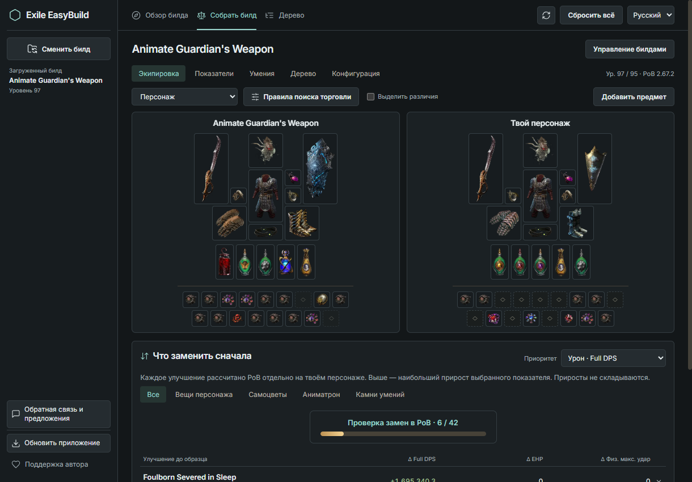
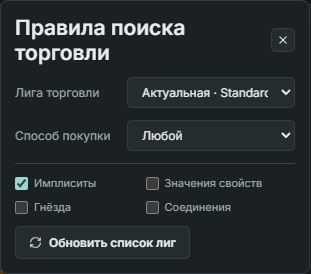
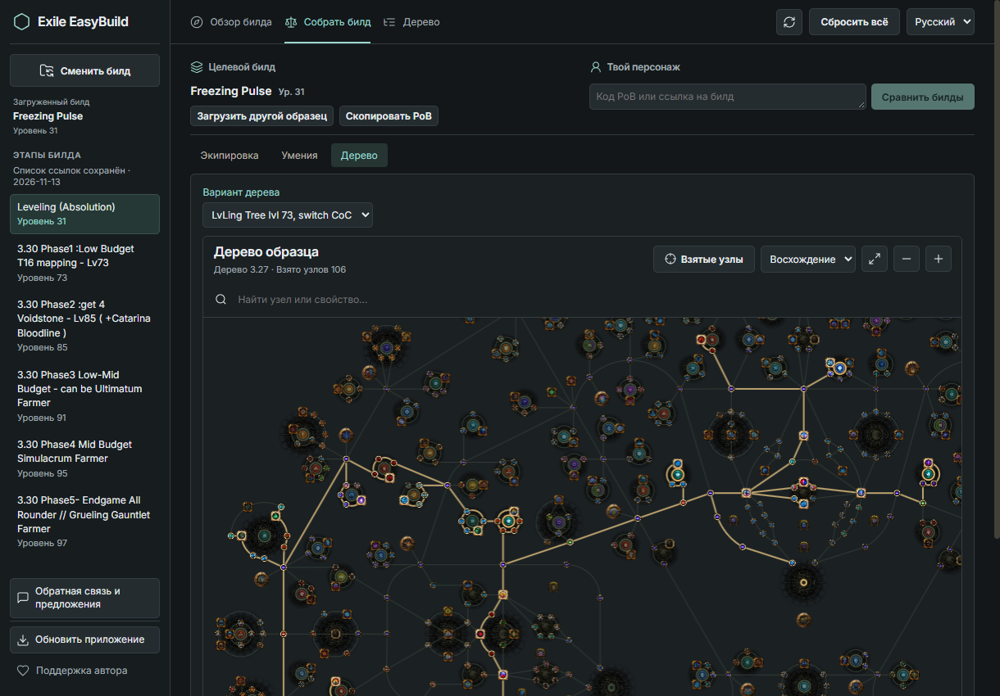
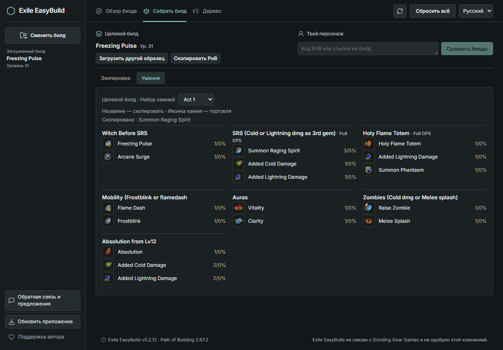
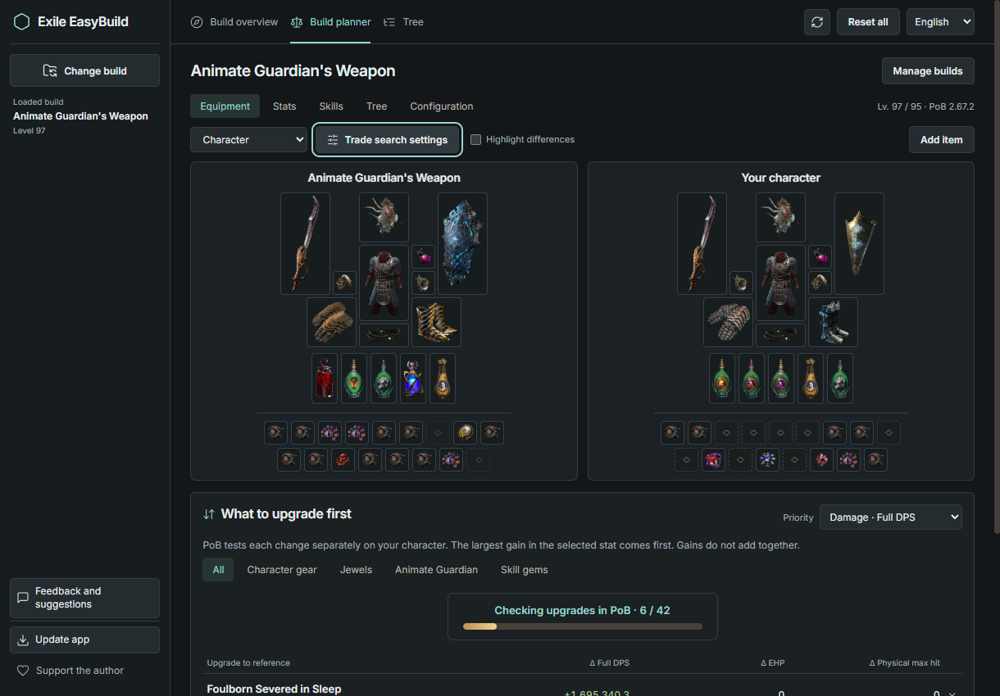
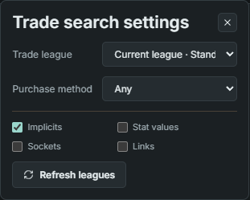

# Exile EasyBuild 0.2.13

**Собери персонажа по чужому PoB и найди нужную вещь на трейде в один клик.** Бесплатный помощник для Path of Exile 1 на Windows 11 x64. Движок Path of Building Community Fork 2.67.2 входит в установщик.

**[Скачать для Windows x64 · Download for Windows x64](https://github.com/ByJIkA/Exile-EasyBuild/releases/download/v0.2.13/ExileEasyBuild-0.2.13-Windows-x64.exe)** · [GitHub Release](https://github.com/ByJIkA/Exile-EasyBuild/releases/tag/v0.2.13) · [English](#english)

## Как собрать билд по гайду

1. Нажми **«Загрузить билд»** и вставь код PoB или ссылку на pobb.in. Подойдут также poedb.tw/pob, ссылка на персонажа PoE 1 с poe.ninja или видео на YouTube со ссылками на билды в описании.
2. Открой **«Собрать билд»**. Слева выбери этап, к которому стремишься. Справа загрузи своего персонажа или выбери предыдущий этап гайда. Включи **«Выделить различия»**, чтобы приглушить совпадающие предметы. Кольца и флаконы сравниваются между слотами.
3. Перетащи вещь слева на подходящий слот справа. PoB покажет, как изменятся урон, EHP и максимальный выдерживаемый удар **у твоего персонажа**. Клик по примеренной вещи вернёт исходную. Через **«Добавить предмет»** можно примерить и вещь, скопированную с трейда.

### Купить похожую вещь

Нажми на предмет **в левом стенде**. В системном браузере откроется официальный трейд PoE с уже заполненными фильтрами. Например, для перчаток из гайда можно искать те же свойства с любыми значениями. Если нужен шестилинк, включи **«Соединения»** в правилах поиска. Лигу, способ покупки, имплиситы, значения свойств и количество гнёзд тоже можно выбрать там.

### Деревья по уровням в 0.2.13

В «Дерево» или «Собрать билд» → «Дерево» открой **«Вариант дерева»**. Список берётся из текущего PoB. Например, в первом этапе гайда Leveling (Absolution) доступны деревья для уровней 12, 24, 31, 40, 50, 60 и 73. Просмотр меняет только дерево на экране; текущий этап, экипировка и камни сохраняются.

### Камни по актам

Открой **«Собрать билд» → «Умения»** и выбери набор камней автора. Для гайда по прокачке доступны Act 1, Act 2, Act 3 и Act 4-10, если они сохранены в PoB. Вкладка работает и с одним загруженным билдом. При сравнении двух персонажей набор выбирается отдельно для каждой стороны.

Нажми на **название камня**, чтобы скопировать его. Клик по **иконке** открывает поиск по уровню и качеству на трейде.

**Уже пользуешься приложением?** Нажми **«Обновить приложение» → «Скачать обновление» → «Сохранить и перезапустить»**. Клиент сохранит билд, этап, временную сумку и примерки перед установкой. Для первого запуска или старой версии без кнопки обновления используй установщик выше.

## English

**Build toward someone else’s PoB and find the gear on the official trade site in one click.** Exile EasyBuild is a free Path of Exile 1 companion for Windows 11 x64. The installer includes Path of Building Community Fork 2.67.2.

**[Download v0.2.13 for Windows x64](https://github.com/ByJIkA/Exile-EasyBuild/releases/download/v0.2.13/ExileEasyBuild-0.2.13-Windows-x64.exe)**

1. Select **Load build** and paste a PoB code or pobb.in link. You can also import a poedb.tw/pob link, a PoE 1 character from poe.ninja, or a YouTube guide with supported build links in its description.
2. Open **Build planner**. Choose your target stage on the left. Import your character or select an earlier stage on the right. Highlight differences to dim matching gear. The planner matches rings and flasks even when their slots differ.
3. Drag an item from the target onto your character. PoB recalculates your damage, effective hit pool and maximum hit taken. Click the fitted item to restore the original. You can also paste an item copied from trade into the temporary bag and try it on.

### One-click trade search

Click an item **on the left gear stand** to open the official PoE trade site in your browser with filters filled in. Looking for gloves with the same modifiers? Leave modifier values off to include different rolls. Need a six-link? Enable the links filter. You can also choose the league, purchase method, implicits and socket count.

### Leveling trees in 0.2.13

Open **Tree** or **Build planner → Tree**, then choose a **Tree variant** from the current PoB. The Leveling (Absolution) example includes trees for levels 12, 24, 31, 40, 50, 60 and 73. You can preview each allocation while keeping the same build stage, items and gems.

### Gems by act

Open **Build planner → Skills** to browse the gem sets saved by the guide author, including per-act setups. Only one build is needed. When comparing two builds, choose a set independently on each side.

Click a **gem name** to copy it. Click its **icon** to search trade for the displayed level and quality.

**Already installed?** Choose **Update app → Download update → Save and restart**. The client saves your build, selected stage, bag and gear previews before installing. For a first install or a version without the update button, use the Windows installer above.

[Сообщить об ошибке · Report an issue](https://github.com/ByJIkA/Exile-EasyBuild/issues) · [Path of Building Community Fork](https://github.com/PathOfBuildingCommunity/PathOfBuilding)

Exile EasyBuild — независимый проект, не связанный с Grinding Gear Games и не одобренный ими. Exile EasyBuild is not affiliated with or endorsed by Grinding Gear Games.
