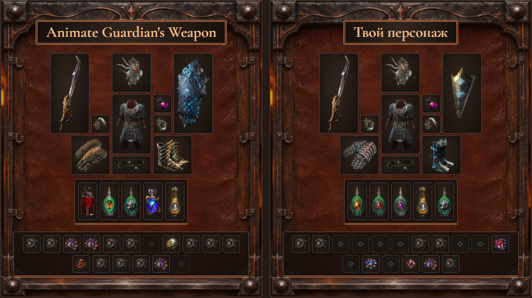
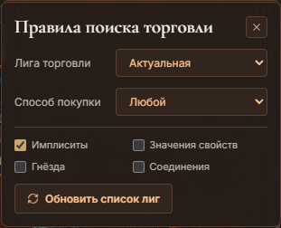
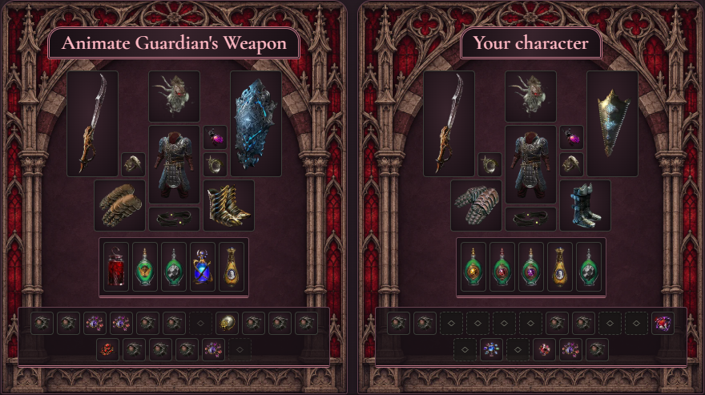
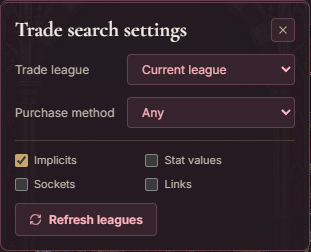

# Exile EasyBuild 0.2.9

**Собери персонажа по чужому PoB и найди нужную вещь на трейде в один клик.** Бесплатный помощник для Path of Exile 1 на Windows 11 x64. Движок Path of Building Community Fork 2.67.2 входит в установщик.

**[Скачать для Windows x64 · Download for Windows x64](https://github.com/ByJIkA/Exile-EasyBuild/releases/download/v0.2.9/ExileEasyBuild-0.2.9-Windows-x64.exe)** · [GitHub Release](https://github.com/ByJIkA/Exile-EasyBuild/releases/tag/v0.2.9) · [English](#english)

## Как собрать билд по гайду

1. Нажми **«Загрузить билд»** и вставь код PoB или ссылку на pobb.in. Подойдут также poedb.tw/pob, ссылка на персонажа PoE 1 с poe.ninja или видео на YouTube со ссылками на билды в описании.
2. Открой **«Собрать билд»**. Слева выбери этап, к которому стремишься. Справа загрузи своего персонажа или выбери предыдущий этап гайда. Включи **«Выделить различия»**, чтобы приглушить совпадающие предметы. Кольца и флаконы сравниваются между слотами.
3. Перетащи вещь слева на подходящий слот справа. PoB покажет, как изменятся урон, EHP и максимальный выдерживаемый удар **у твоего персонажа**. Клик по примеренной вещи вернёт исходную. Через **«Добавить предмет»** можно примерить и вещь, скопированную с трейда.

### Купить похожую вещь

Нажми на предмет **в левом стенде**. В системном браузере откроется официальный трейд PoE с уже заполненными фильтрами. Например, для перчаток из гайда можно искать те же свойства с любыми значениями. Если нужен шестилинк, включи **«Соединения»** в правилах поиска. Лигу, способ покупки, имплиситы, значения свойств и количество гнёзд тоже можно выбрать там.

### Что исправлено в 0.2.9

- Поиск запрашивает у GGG лиги для PC. Если у свойства нет соответствующего фильтра на трейде, клиент перечислит пропущенные свойства.
- Переставленные кольца и флаконы больше не создают лишних рекомендаций в «Что заменить сначала».
- На обоих стендах Two-Stone Ring отображаются иконками. Наведи курсор, чтобы увидеть вариант базы и свойства конкретного кольца.
- «Открыть в PoB» учитывает выбранный вручную комплект аниматрона. Импорт также принимает код PoB в кавычках из сообщения.

**Уже пользуешься приложением?** Нажми **«Обновить приложение» → «Скачать обновление» → «Сохранить и перезапустить»**. Клиент сохранит билд, этап, временную сумку и примерки перед установкой. Для первого запуска или старой версии без кнопки обновления используй установщик выше.

## English

**Build toward someone else’s PoB and find the gear on the official trade site in one click.** Exile EasyBuild is a free Path of Exile 1 companion for Windows 11 x64. The installer includes Path of Building Community Fork 2.67.2.

**[Download v0.2.9 for Windows x64](https://github.com/ByJIkA/Exile-EasyBuild/releases/download/v0.2.9/ExileEasyBuild-0.2.9-Windows-x64.exe)**

1. Select **Load build** and paste a PoB code or pobb.in link. You can also import a poedb.tw/pob link, a PoE 1 character from poe.ninja, or a YouTube guide with supported build links in its description.
2. Open **Build planner**. Choose your target stage on the left. Import your character or select an earlier stage on the right. Highlight differences to dim matching gear. The planner matches rings and flasks even when their slots differ.
3. Drag an item from the target onto your character. PoB recalculates your damage, effective hit pool and maximum hit taken. Click the fitted item to restore the original. You can also paste an item copied from trade into the temporary bag and try it on.

### One-click trade search

Click an item **on the left gear stand** to open the official PoE trade site in your browser with filters filled in. Looking for gloves with the same modifiers? Leave modifier values off to include different rolls. Need a six-link? Enable the links filter. You can also choose the league, purchase method, implicits and socket count.

### Changes in 0.2.9

- Trade search requests PC leagues from GGG. If a modifier has no matching trade filter, the client shows which one was omitted.
- Swapping ring or flask positions no longer creates redundant upgrade suggestions.
- Both gear stands show Two-Stone Ring artwork. Hover over either ring to inspect its base variant and modifiers.
- Opening a character in PoB respects your manually selected Animate Guardian gear set. You can also paste a PoB code surrounded by quotation marks.

**Already installed?** Choose **Update app → Download update → Save and restart**. The client saves your build, selected stage, bag and gear previews before installing. For a first install or a version without the update button, use the Windows installer above.

[Сообщить об ошибке · Report an issue](https://github.com/ByJIkA/Exile-EasyBuild/issues) · [Path of Building Community Fork](https://github.com/PathOfBuildingCommunity/PathOfBuilding)

Exile EasyBuild — независимый проект, не связанный с Grinding Gear Games и не одобренный ими. Exile EasyBuild is not affiliated with or endorsed by Grinding Gear Games.
